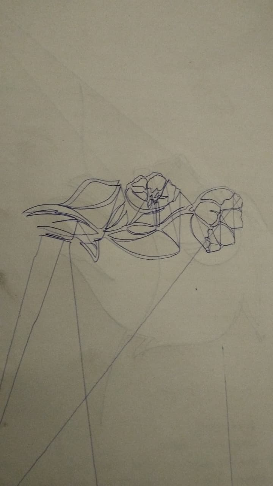

# CNC Drawing Machine (XY Pen Plotter)

A 2-axis pen plotter built from scratch. It has 3D-printed mechanics, a custom ATmega328P PCB, bare-metal AVR-C G-code firmware, and a Python desktop app that turns any image into a drawing.

| Plotted output | Plotted output |
|---|---|
|  |  |

## Highlights

- **Drawing area:** 275 × 190 mm, two NEMA 17 steppers at 80 steps/mm, limit-switch homing
- **Firmware:** register-level AVR-C. No Arduino core and no libraries. Parses G-code over UART, interpolates lines, and runs the pen servo with software PWM in a Timer1 interrupt
- **Custom PCB:** designed in EasyEDA around the ATmega328P
- **Plotter Studio:** a Tkinter + OpenCV app. Load an image, convert it to G-code, preview the pen path, and stream it to the machine
- **Verified end to end:** a 1,310-line drawing streamed with zero dropped lines (see [`docs/hardware-test-log.txt`](docs/hardware-test-log.txt))

## Repository layout

```
firmware/
  avr-c/
    xy_gcode_plotter.c        main firmware (ATmega328P @ 16 MHz)
    variants/                 8 MHz crystal / internal RC, hardware-PWM, servo-on-PD4, no-servo builds
    tests/                    bring-up programs: blink, servo, limit switches, homing, circle, OSCCAL tuning
  arduino/                    original Arduino sketches the AVR-C code was ported from
software/
  plotter_studio.py           GUI: image -> G-code -> preview -> stream
  gcode_converter.py          image -> G-code pipeline (no GUI, usable standalone)
  send_gcode.py               command-line G-code streamer
hardware/
  pcb/                        schematic, PCB layout, Gerbers, EasyEDA project
  3d-parts/                   printable STL parts (frame ends, carriages, pen slider, servo housing, enclosure)
docs/                         user manual, user guide, presentation, test log, reference build guide
examples/gcode/               sample G-code (circle, flower)
media/                        photos of plotted results
```

## Pin map (ATmega328P)

| Function | X axis | Y axis |
|---|---|---|
| STEP | PB0 (D8) | PD6 (D6) |
| DIR | PB1 (D9) | PD5 (D5) |
| ENABLE | PB2 (D10) | PD7 (D7) |
| LIMIT switch | PD2 (D2) | PD3 (D3) |

The pen servo signal is on PB3 (D11). The `xy_gcode_plotter_PD4.c` variant moves it to PD4 (D4).

## Supported G-code

| Code | Action |
|---|---|
| `G0` / `G1` | Rapid / drawing move (`X`, `Y`) |
| `G20` / `G21` | Inches / millimetres |
| `G90` / `G91` | Absolute / relative positioning |
| `G28` | Home both axes |
| `M3` / `M5` | Pen down / pen up (`Z ≤ 0` also lowers the pen) |

The firmware replies `ok` after every line, so the host can control the flow. The serial port runs at 9600 baud.

## Getting started

### 1. Flash the firmware

```bash
cd firmware/avr-c
avr-gcc -mmcu=atmega328p -Os -o plotter.elf xy_gcode_plotter.c -lm
avr-objcopy -O ihex -R .eeprom plotter.elf plotter.hex
avrdude -c usbasp -p m328p -U flash:w:plotter.hex:i
```

Change `-c usbasp` to match your programmer. If the board runs at 8 MHz, use a build from `variants/` instead.

### 2. Run Plotter Studio

```bash
cd software
pip install -r requirements.txt
python plotter_studio.py
```

Load an image, click **Generate Preview**, pick the COM port, and stream it to the machine.

To stream a G-code file from the command line instead:

```bash
python send_gcode.py ../examples/gcode/circle.gcode COM3
```

## Credits

- The mechanical design is adapted from the open-source *Easy 3D Printable CNC Drawing Machine* (Arduino / GRBL plotter). Its build guide is in [`docs/reference-build-guide.pdf`](docs/reference-build-guide.pdf).
- The NEMA 17 motor bracket for 2020 V-slot is by PrintError on Thingiverse ([thing:2449504](https://www.thingiverse.com/thing:2449504)), licensed CC BY-SA. See [`hardware/3d-parts/nema17-bracket`](hardware/3d-parts/nema17-bracket).
- The firmware, PCB, and image-to-G-code software are original work by Inuka Gamage.
